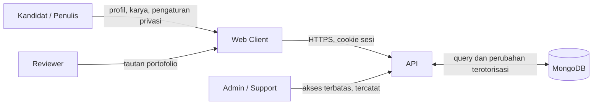
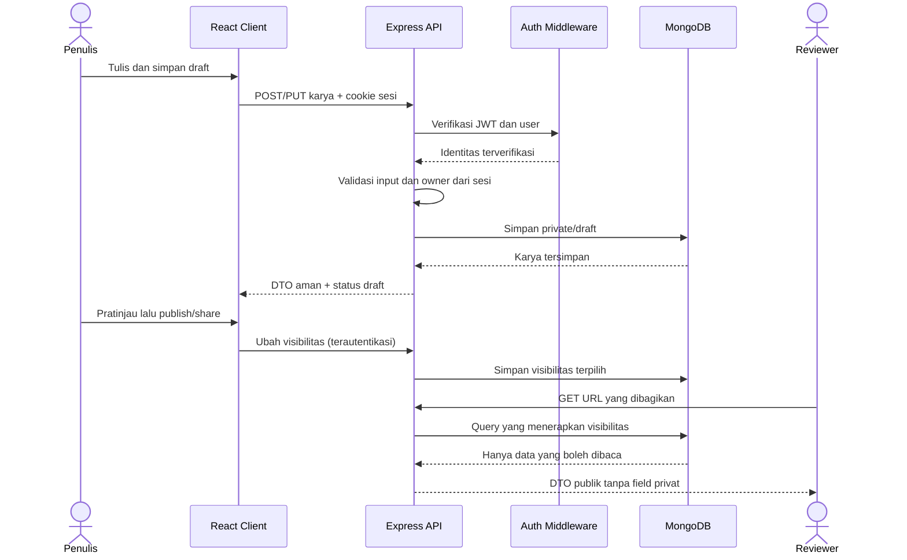
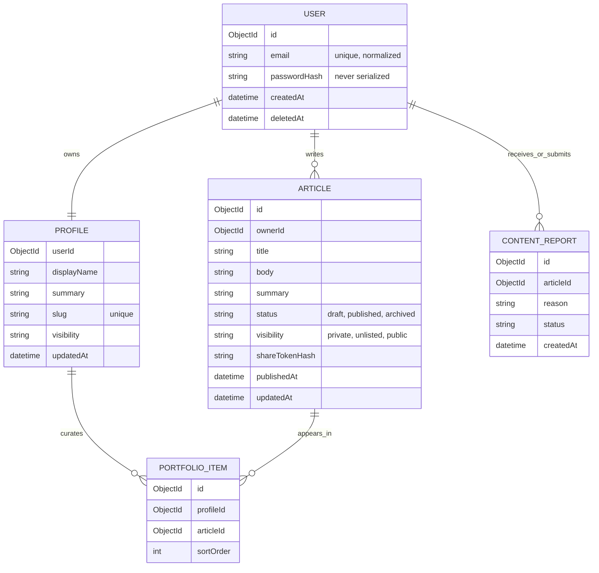

# DFO — Data Flow Overview

**Versi:** 0.1 — target rancangan MVP  
**Catatan:** alur di bawah menggambarkan sistem yang direncanakan. Implementasi saat ini mencakup auth API; profil, karya, portofolio, dan moderasi belum diimplementasikan.

## 1. Aktor, komponen, dan penyimpanan

- **Kandidat/penulis:** membuat dan mengatur profil serta karya.
- **Reviewer:** membaca karya yang dibagikan.
- **Web client:** aplikasi React/Vite; mengirim API request dan menampilkan hasil.
- **API:** validasi, autentikasi, otorisasi kepemilikan, aturan visibilitas, dan serialisasi respons.
- **MongoDB:** akun, profil, karya, konfigurasi portofolio, laporan, dan audit keamanan minimum.
- **Admin/support (fase MVP):** menindaklanjuti laporan sesuai akses terbatas dan tercatat.

## 2. Diagram konteks

## 3. Aliran utama

### A. Register dan login

1. Client mengirim email, username, dan password ke `POST /api/auth/register`, atau email/password ke `POST /api/auth/login`.
2. API memvalidasi bentuk dan batas input; rate limiter membatasi percobaan.
3. Saat register, API menormalkan email, memeriksa duplikasi, meng-hash password, lalu menyimpan user.
4. Saat login, API mengambil hash password secara eksplisit dan membandingkan dengan password yang dikirim.
5. API membuat JWT berisi subject user dan mengirimnya melalui cookie HttpOnly; respons body hanya memuat data publik user.
6. Request terlindungi membawa cookie. Middleware memverifikasi signature, issuer, audience, expiry, lalu memuat user yang masih ada.
7. Logout menghapus cookie di client; endpoint saat ini tidak memiliki denylist/revocation server-side.

### B. Menulis dan menyimpan draft (target)

1. Kandidat mengirim payload karya ke endpoint terautentikasi.
2. API memvalidasi field, ukuran, status, dan tipe konten; memperlakukan semua input sebagai tidak tepercaya.
3. API menurunkan owner ID dari sesi, bukan mempercayai owner ID yang dikirim client.
4. API menyimpan karya sebagai private/draft secara default.
5. API mengembalikan DTO aman dan versi/update timestamp untuk mendeteksi konflik perubahan.

### C. Membaca portofolio/karya

1. Reviewer membuka URL publik atau unlisted.
2. API mencari hanya resource yang sesuai URL dan kebijakan visibilitas; draft/private tidak boleh lolos query/serializer.
3. API menyingkirkan field internal, data kontak yang tidak dipilih, draft, token, dan metadata moderasi.
4. Client merender teks dengan encoding/sanitasi yang aman.
5. Respons unlisted memakai `noindex` dan URL berbagi berentropi tinggi; siapa pun yang memperoleh tautan tetap dapat meneruskannya.

### D. Mengubah privasi/menghapus

1. Penulis terautentikasi mengirim perubahan visibilitas/penghapusan.
2. API memeriksa owner ID, aturan transisi, dan konfirmasi tindakan.
3. Perubahan disimpan; cache dan indeks yang terkait diinvalidasi.
4. Permintaan berikutnya untuk resource privat/unpublished ditolak tanpa mengungkap konten.
5. Penghapusan akun mengikuti kebijakan retensi, penghapusan relasi, backup expiry, dan kewajiban legal yang diumumkan.

## 4. Diagram aliran data karya

## 5. Model data domain awal

`shareTokenHash` adalah opsi implementasi untuk tautan unlisted yang revocable; jangan menyimpan token mentah bila fitur tersebut dipilih. `CONTENT_REPORT` perlu desain tambahan untuk laporan anonim, retensi, serta akses admin. Model ini usulan, bukan schema yang telah dibuat.

## 6. Klasifikasi data dan kontrol

| Data | Klasifikasi | Akses | Kontrol minimum |
|---|---|---|---|
| Password dan JWT | Rahasia | API saja | Hash password; JWT hanya di HttpOnly cookie; redaksi log |
| Email/login metadata | Pribadi | Pemilik dan layanan auth | Normalisasi, minimisasi, tidak tampil pada halaman publik secara default |
| Draft tulisan | Pribadi/rahasia pengguna | Pemilik dan service terbatas | Private default, owner check pada setiap operasi, tidak masuk search/index publik |
| Tulisan public | Publik pilihan penulis | Siapa pun | Persetujuan publish eksplisit, takedown mudah, sanitasi render |
| Tulisan unlisted | Terbatas melalui tautan | Pemegang tautan | Token acak, revocable, noindex; jelaskan risiko penerusan link |
| Audit/security logs | Internal | Operator berwenang | Minimasi, retensi terbatas, tanpa isi draft/token/password |

## 7. Batas kepercayaan dan ancaman yang perlu ditangani

- Client, input tulisan, file/URL, dan header request tidak tepercaya.
- Akses data privat selalu memerlukan otorisasi di API; menyembunyikan tombol di client bukan kontrol akses.
- Cookie auth memerlukan konfigurasi CORS dan CSRF yang benar. Jika deployment lintas site memerlukan `SameSite=None`, wajib Secure, proteksi CSRF terencana, dan origin allowlist yang eksplisit.
- Konten tulisan dapat membawa XSS, tautan phishing, rahasia perusahaan, PII, atau materi berhak cipta.
- URL unlisted adalah bearer access: siapa pun yang memiliki tautan dapat membacanya sampai token dicabut.
- Operasi publish, delete, ekspor, dan admin perlu audit event minimal tanpa menyalin isi konten ke log.
- Backup, observability, analytics, dan CDN/cache harus mengikuti klasifikasi visibilitas yang sama.
